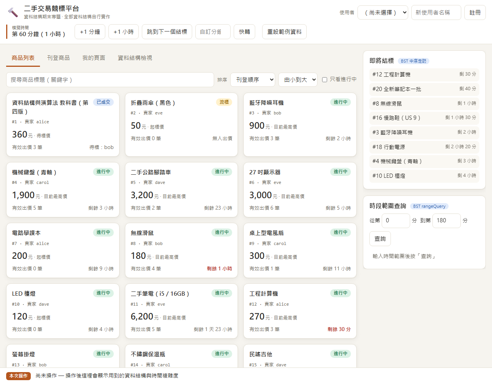
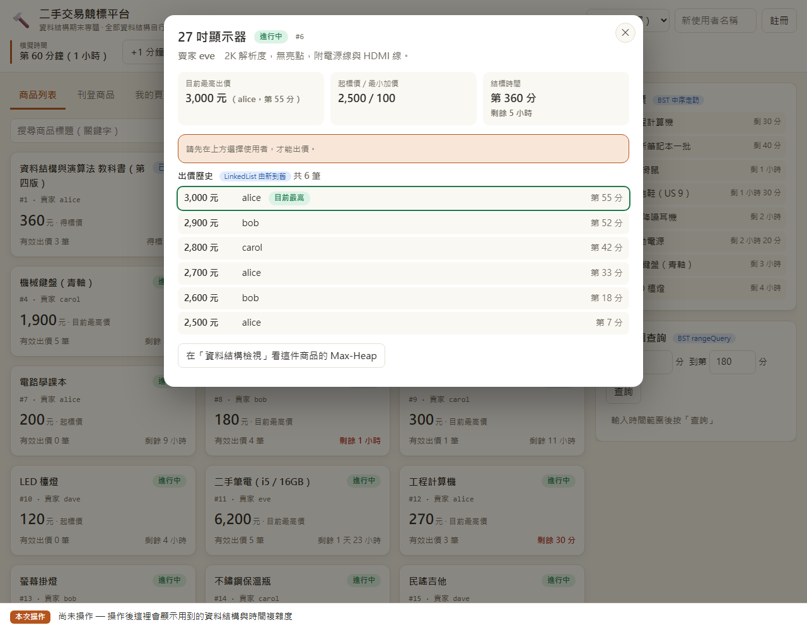
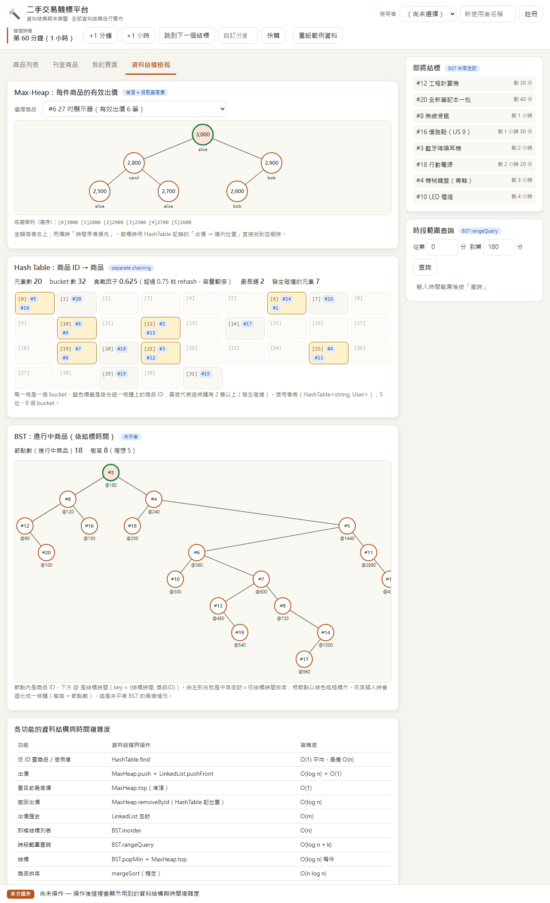

# 二手交易競標平台

> 資料結構（電機四技二甲，許協誌老師）期末專題 · 題目 #11「二手交易競標平台」 · 開發者：趙加銘（單人完成）

一個可運行的二手商品競標系統：刊登、搜尋、出價、撤標、結標、排序、範圍查詢。
**所有核心資料結構都是自己實作的**（不使用任何內建容器），並提供三種執行方式：

| 版本 | 說明 |
|---|---|
| 🌐 **網頁版（線上 Demo）** | <https://zhao-926.github.io/bidding-system/> — 純靜態網頁，資料存在瀏覽器 `localStorage`，內建「資料結構檢視」面板，每次操作都會顯示用到的資料結構與時間複雜度 |
| 💻 **CLI 版** | 終端機數字選單，C++17 |
| 🧪 **測試與效能對照** | C++ 與 JavaScript 各有一套單元測試；`bench/` 以 STL 當對照組 |



| 商品詳情（出價、出價歷史） | 資料結構檢視（Heap／Hash Table／BST） |
|---|---|
|  |  |

---

## 使用的資料結構

| 資料結構 | 用在哪裡 | 檔案 |
|---|---|---|
| **Hash Table**（separate chaining、rehash） | 商品 ID → 商品、使用者名稱 → 使用者、bidId → Heap 位置 | `core/HashTable.h` |
| **Max-Heap**（Priority Queue，支援任意刪除） | 每件商品目前的最高出價；撤標 | `core/MaxHeap.h` |
| **Linked List**（單向） | 每件商品的出價歷史（新的插在最前面） | `core/LinkedList.h` |
| **BST**（二元搜尋樹） | 進行中商品依 (結標時間, ID) 排序：即將結標、範圍查詢、結標 | `core/BST.h` |
| **Merge Sort**（穩定） | 商品列表依價格／出價數／結標時間排序 | `core/MergeSort.h` |
| **Dynamic Array** | Heap 底層、各種清單 | `core/DynArray.h` |

> 規範：`core/`（C++）與 `web/js/core/`（JavaScript）**禁止使用內建容器與內建排序**（STL 的 `vector`、`map`、`priority_queue`、`std::sort`…；JS 的 `Map`、`Set`、`Array.prototype.sort`…）。`make check` 會自動檢查。STL 只出現在 `bench/`，當效能對照組。
> 每個公開操作都在函式上方註解標明時間複雜度，彙整見 [`docs/complexity.md`](docs/complexity.md)。

## 功能

| 編號 | 功能 | 編號 | 功能 |
|---|---|---|---|
| F1 | 註冊／切換使用者 | F9 | 即將結標列表（BST 中序走訪） |
| F2 | 刊登商品 | F10 | 結標時段範圍查詢（BST） |
| F3 | 依 ID 查商品（Hash Table） | F11 | 結標／流標 |
| F4 | 關鍵字搜尋 | F12 | 商品列表排序（Merge Sort） |
| F5 | 出價（起標價、最小加價、賣家不能出價…） | F13 | 我的頁面（我賣的／出價的／得標的） |
| F6 | 查目前最高出價（Heap 堆頂） | F14 | 模擬時鐘快轉 |
| F7 | 查出價歷史（Linked List） | F15 | 存檔／讀檔 |
| F8 | 撤回出價（Heap 任意刪除） | F16 | 重設為範例資料（5 人、20 件商品、45 筆出價） |

所有錯誤（出價太低、已結標、找不到商品…）都會回傳明確的中文訊息，不會 crash。
**時間使用「模擬時鐘」**：Demo 時可以一鍵快轉到下一個結標時間，不用真的等。

---

## 環境需求

| 工具 | 用途 | 版本（開發時使用） |
|---|---|---|
| g++（支援 C++17） | 編譯 CLI、測試、bench | 14.2.0（MSYS2 UCRT64） |
| make | 執行 Makefile | GNU Make 4.4.1（Windows MSYS2 請用 `mingw32-make`，用法相同） |
| bash | `make check` 的檢查腳本 | Git Bash／MSYS2 |
| Node.js | JS 核心測試 | 20 以上（開發時 26） |
| Python 3（選用） | 本機預覽網頁 | 3.12 |

## 編譯與執行

以下指令都在專案根目錄執行（Windows 若沒有 `make`，把 `make` 換成 `mingw32-make`）。

```bash
make test        # 編譯並執行 C++ 單元測試（107 個測試案例，含隨機測試與暴力解比對）
make check       # 檢查 core/ 與 web/js/core/ 沒有使用被禁止的內建容器
make test-js     # 執行 JS 核心測試（37 個，含「JS 與 C++ 範例資料逐位元組相同」的比對）
make cli         # 編譯 CLI → build/auction_cli
make bench       # 編譯並執行效能對照，結果寫入 docs/benchmark.md（約需 15 秒）
make web         # 部署前檢查：網頁檔案齊全、相對路徑、JS 測試
make sample      # 重新產生 data/sample.txt（範例資料有改動時才需要）
make clean       # 刪除 build/
```

### CLI

```bash
make cli
./build/auction_cli                  # 啟動時讀 data/sample.txt（找不到就用內建範例資料）
./build/auction_cli my_save.txt      # 讀指定的存檔
./build/auction_cli --empty          # 從空白系統開始
```

數字選單包含全部功能；每次操作後會顯示 `[資料結構] …` 提示用到的結構與複雜度。
範例流程「刊登 → 多人出價 → 撤標 → 快轉 → 結標」：選單 `1`（註冊使用者）→ `2`（刊登）→ 切換使用者後 `6`（出價）→ `7`（撤標）→ `11`（時鐘快轉，結標）→ `5`（看結果）。

### 網頁（本機預覽）

網頁是純靜態的，沒有建置步驟（`web/` 資料夾就是網站）。因為使用 ES Module，需要透過 http 開啟（直接雙擊 `index.html` 不行）：

```bash
python -m http.server -d web 8000
# 然後開啟 http://localhost:8000/
```

網址後面可以加 `#list`、`#sell`、`#mine`、`#ds`（資料結構檢視）或 `#item=6`（直接開啟商品詳情）。

---

## 網頁版如何與 C++ 版共用演算法

網頁版沒有使用 WebAssembly，而是把 `core/` **一比一移植成 JavaScript**（`web/js/core/`，檔名與 C++ 一一對應，連註解與複雜度標示都相同）。為了證明兩邊行為一致：

- 兩個版本的存檔格式完全相同（文字檔，見 [`HANDOFF.md`](HANDOFF.md)）；
- JS 測試會載入內建範例資料後存檔，並與 **C++ 產生的 `data/sample.txt` 逐位元組比對**；也會讓 JS 讀取 C++ 的存檔再存出，結果仍相同。

## 專案結構

```
core/        C++ 核心：DynArray、LinkedList、HashTable、MaxHeap、BST、MergeSort、Models、AuctionSystem
cli/         終端機介面
web/         網頁（index.html、style.css、app.js）與 web/js/core/（JS 版核心）
tests/       C++ 測試（自寫框架）與 tests/js/（JS 測試）
bench/       自刻 vs STL 效能對照
data/        sample.txt（範例資料存檔）
scripts/     check_no_stl.sh、build_web.sh
docs/        架構圖、複雜度分析、效能報告、Demo 腳本、分工說明
.github/     GitHub Actions：測試通過後部署 Pages
```

## 文件

| 文件 | 內容 |
|---|---|
| [`docs/architecture.md`](docs/architecture.md) | 系統架構圖與「出價」「結標」資料流程圖（Mermaid） |
| [`docs/complexity.md`](docs/complexity.md) | 每個操作的時間複雜度、為什麼選這個資料結構、效能對照摘要 |
| [`docs/benchmark.md`](docs/benchmark.md) | 自刻 vs STL 完整量測結果（`make bench` 產生） |
| [`docs/demo-script.md`](docs/demo-script.md) | 3–5 分鐘錄影／口頭報告腳本 |
| [`docs/contribution.md`](docs/contribution.md) | 分工說明（單人完成） |
| [`HANDOFF.md`](HANDOFF.md) | 給其他開發者／AI 的交接文件 |
| [`PLAN.md`](PLAN.md) | 實作計畫書與完成檢查表 |

## 部署

推送到 `main` 時，GitHub Actions（`.github/workflows/deploy.yml`）會先執行 C++ 測試、`make check`、JS 測試，全部通過才把 `web/` 發布到 GitHub Pages。
