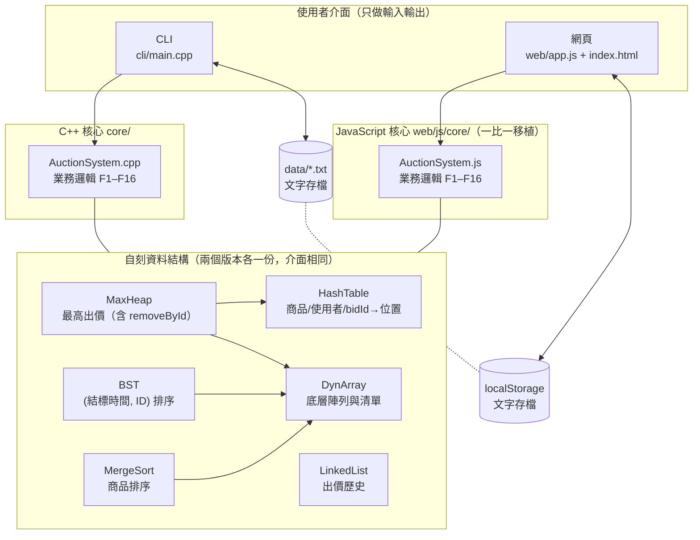
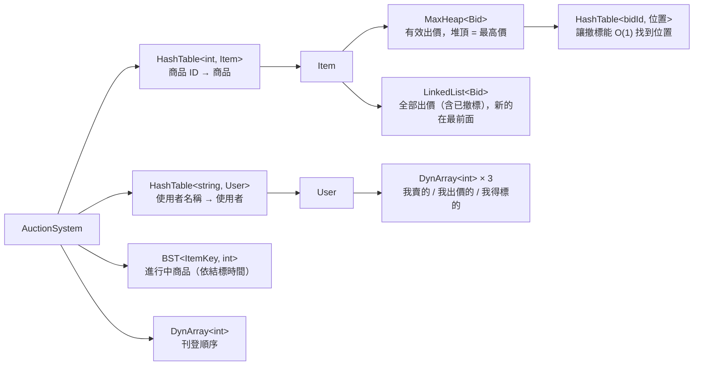
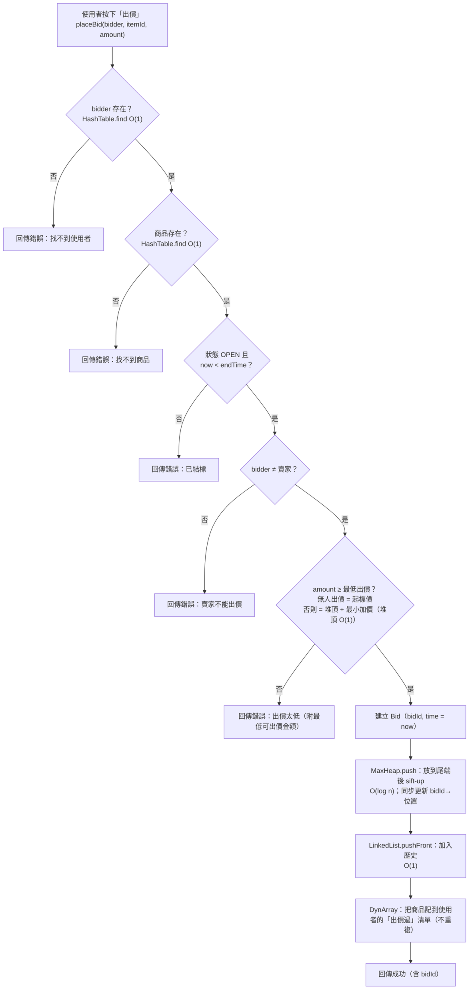
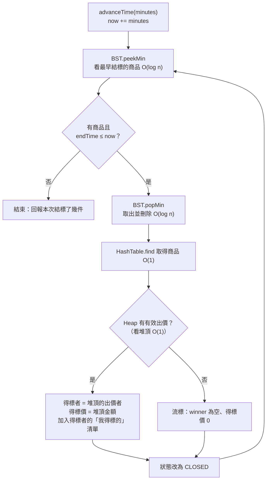

# 系統架構

> 圖表使用 [Mermaid](https://mermaid.js.org/)，可直接在 GitHub 上渲染。

## 1. 模組分層

使用者介面（CLI 或網頁）只負責輸入／輸出；所有規則都在 `AuctionSystem`，由它組合各個自刻資料結構。
**C++ 版與 JavaScript 版是同一份設計的兩個實作**，介面與行為一致（以存檔格式逐位元組比對驗證）。



## 2. AuctionSystem 內部持有的資料結構



## 3. 資料流程：出價（F5）



**撤標（F8）** 是出價的反向：在歷史（由新到舊）中找到該使用者最新的有效出價 → 用 `bidId→位置` 的 HashTable 找到它在 Heap 的位置 → `removeById`（與最後一個元素交換、sift-up 或 sift-down，O(log n)）→ 把歷史中那筆標記為「已撤標」（歷史保留）。

## 4. 資料流程：結標（F11）

模擬時鐘每次前進（`advanceTime`），就讓所有「結標時間 ≤ 現在」的商品結標。BST 以 (結標時間, ID) 排序，所以最早到期的永遠是最小的節點。



## 5. 存檔格式（C++ 與 JS 共用）

文字檔、一行一筆、欄位以 `|` 分隔（標題等文字中的 `%`、`|`、換行會先跳脫成 `%25`、`%7C`、`%0A`）。
出價依 bidId 由小到大存放，讀檔時依序「重播」就能還原 Heap 與出價歷史。
讀檔採「先在暫存系統試解析，成功才取代現有資料」，所以壞檔不會破壞目前資料。

```text
AUCTION_V1
now|60
nextItemId|21
nextBidId|46
user|alice
item|<id>|<賣家>|<標題>|<描述>|<起標價>|<最小加價>|<結標時間>|<狀態 0=進行中 1=已結標>|<得標者>|<得標價>
bid|<bidId>|<itemId>|<出價者>|<金額>|<時間>|<有效 1/0>
```
